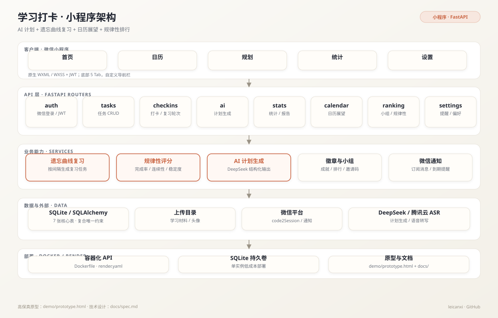
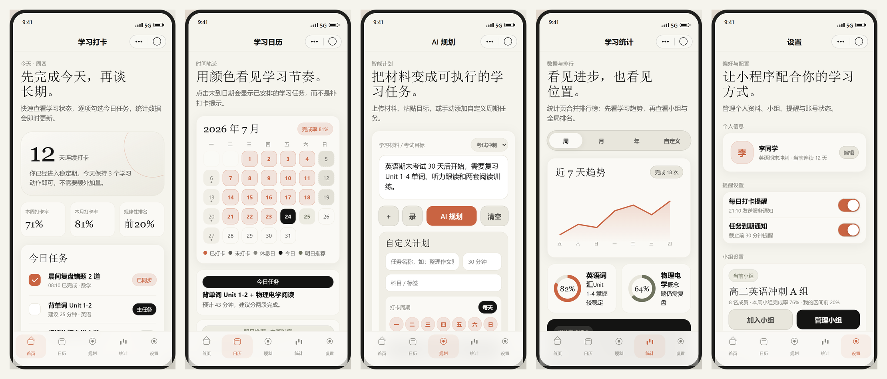
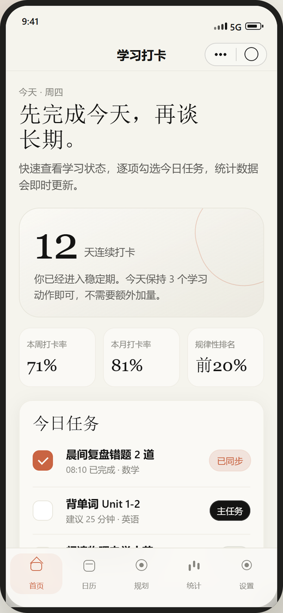
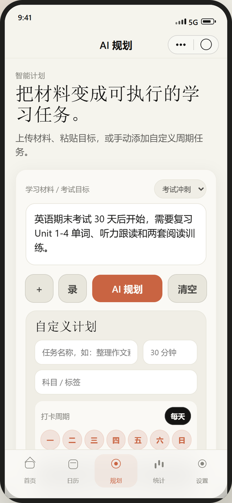
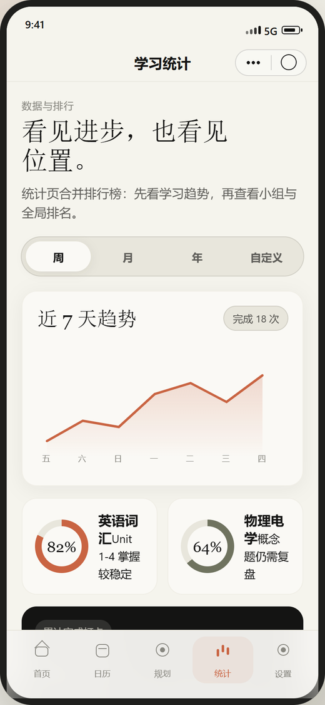

<div align="center">
  <h1>学习打卡 · Learning Check-in</h1>
  <p><strong>AI 计划 + 遗忘曲线复习 + 日历展望 + 规律性排行</strong></p>
  <p>微信小程序 · FastAPI · SQLite · DeepSeek</p>

  <p>
    
    
    
    
    
  </p>

  <p>
    <a href="#功能">功能</a> ·
    <a href="#架构">架构</a> ·
    <a href="#界面">界面</a> ·
    <a href="#快速开始">快速开始</a> ·
    <a href="#api-一览">API</a> ·
    <a href="docs/PRD.md">PRD</a>
  </p>
</div>

## 项目简介

一个面向学生和自律学习者的微信小程序：把「打卡」从单纯的记录行为，变成**计划、执行、复习、反馈**的闭环。

和普通打卡工具的区别：

- **AI 参与计划**：输入目标、材料与可用时间，生成可执行的任务清单；
- **遗忘曲线复习**：根据任务间隔生成复习任务，而不是只记录「今天打了卡」；
- **日历展望**：按天查看已完成、待完成与即将到期；
- **规律性排行**：按完成率、连续性、稳定度综合计算，只展示区间，不公开具体学习内容；
- **小组与徽章**：邀请码组队、组内完成率、成就徽章。

## 功能

| 模块 | 能力 |
|---|---|
| 任务 | 主任务 / 轻量任务 / 复习任务；周期位掩码；建议时长；难度；批量创建 |
| 打卡 | 单任务打卡、补卡、按日期查询、修改与删除；同一用户同一任务同一天唯一 |
| AI 规划 | 根据目标与材料生成计划；上传学习材料；语音转文字；生成进度查询 |
| 复习 | AI 推荐复习间隔（如 `[1,2,4,7,15]`），自动生成子任务与复习轮次 |
| 日历 | 月视图、今日、明日；完成状态与任务摘要 |
| 统计 | 完成率、科目分布、趋势、连续天数；导出 PDF 报告 |
| 排行 | 个人排名区间、小组排行、规律性评分 |
| 徽章 | 规律达人、习惯养成者、进步之星、连续打卡、科目坚持等 |
| 小组 | 创建 / 加入 / 退出、成员列表、邀请码、组内完成率 |
| 设置 | 提醒开关与时间、时区、头像与学习目标 |
| 通知 | 微信订阅消息模板预留；个人测试号阶段使用小程序内弹窗与轮询 |

## 架构

<p align="center">
  
</p>

- **前端**：微信小程序原生 WXML / WXSS / JS，底部 5 个 Tab，自定义导航栏，JWT 鉴权。
- **后端**：FastAPI + SQLAlchemy，按 `auth / tasks / checkins / ai / stats / calendar / ranking / settings` 拆分路由。
- **数据**：SQLite 单文件，7 张核心表；`checkins` 使用 `(user_id, task_id, checkin_date)` 复合唯一约束防止重复打卡。
- **外部能力**：微信 `code2Session` 登录、DeepSeek 计划生成、腾讯云 ASR 语音转写、微信订阅消息。
- **部署**：Docker + Render（`render.yaml`），SQLite 持久卷，适合单实例低成本运行。

## 界面

以下截图来自仓库内的高保真交互原型 [demo/prototype.html](demo/prototype.html)，与小程序页面结构、配色和交互一致。

<p align="center">
  
</p>

| 首页 | AI 规划 | 统计 |
|:---:|:---:|:---:|
|  |  |  |

## 快速开始

### 后端

```bash
cd backend
cp .env.example .env
# 修改 JWT_SECRET_KEY、DEEPSEEK_API_KEY、WECHAT_APPID / WECHAT_APPSECRET

python -m venv .venv
# Linux / macOS
. .venv/bin/activate
# Windows PowerShell
# .venv\Scripts\Activate.ps1

pip install -r requirements.txt
uvicorn main:app --reload --port 8000
```

访问：

- 健康检查：`http://127.0.0.1:8000/`
- Swagger：`http://127.0.0.1:8000/docs`

首次启动会自动建表并初始化默认徽章。

### 小程序

1. 用微信开发者工具打开 `miniapp/`；
2. 在 `miniapp/project.config.json` 中替换为自己的 AppID；
3. 修改 `miniapp/utils/config.js`：

```js
const API_BASES = {
  local: 'http://127.0.0.1:8000',
  remote: 'https://your-api.example.com'
}
const CURRENT_ENV = 'local'
```

4. 开发阶段在开发者工具中勾选「不校验合法域名」；正式号需要在微信后台配置 `request` / `uploadFile` 合法域名。

> 注意：仓库默认配置里本地端口是 `8001`，后端默认启动端口是 `8000`。启动时二选一保持一致即可。

### 高保真原型

无需启动后端，直接双击 `demo/prototype.html`，可点击底部 Tab 查看 5 个页面。

## API 一览

| 前缀 | 能力 |
|---|---|
| `/auth` | 微信登录、邮箱注册 / 登录、当前用户、更新资料、上传头像 |
| `/tasks` | 任务 CRUD、批量创建 |
| `/checkins` | 打卡、补卡、查询、修改、删除 |
| `/ai` | 生成计划、上传材料、语音转文字、生成进度 |
| `/stats` | 完成率、科目分布、趋势 |
| `/calendar` | 月视图、今日、明日 |
| `/ranking` `/badges` | 个人排名、小组排行、徽章 |
| `/settings` `/groups` | 提醒设置、PDF 报告、小组管理 |

完整字段与响应结构见 `docs/spec.md` 与运行后的 `/docs`。

## 数据模型

7 张核心表：

```text
users          用户、openid、学习目标、提醒偏好
tasks          任务、周期位掩码、AI 生成标记、复习间隔
checkins       打卡记录、复习轮次（唯一约束防重复）
groups         小组、邀请码、创建者
user_groups    用户-小组关联
badges         徽章定义
user_badges    用户-徽章关联
```

设计要点：

- `repeat_days` 使用位掩码（bit0=周一 … bit6=周日，127=每天），比多行排期更简单；
- 复习任务通过 `parent_task_id` 关联原任务，`ai_review_intervals` 保存间隔数组；
- 打卡日期单独存 `checkin_date`，避免同一天多次打卡污染统计；
- 时区固定 `Asia/Shanghai`，统计按自然日聚合。

## 关键设计

1. **AI 是计划生成器，不是真相源**：AI 输出先解析为结构化任务，再由后端校验字段与时间范围后落库。
2. **复习与打卡分离**：复习任务是一等公民，有独立轮次和间隔，不是给原任务再加一条打卡。
3. **统计可解释**：规律性评分由完成率、连续性、稳定度组合，排名只展示区间，降低比较焦虑。
4. **个人测试号友好**：不依赖模板消息、手机号、支付等正式号专属能力；迁移正式号只需改 AppID、域名白名单和 API BaseURL。
5. **低成本部署**：SQLite + 单容器，适合个人项目和小规模内测；后续可平滑迁移 PostgreSQL。

## 测试

```bash
cd backend
pytest
```

现有测试覆盖 AI 路由与时间工具，后续补充认证、打卡唯一约束、统计聚合与日历边界。

## 部署

仓库提供 `Dockerfile` 与 `render.yaml`：

```bash
docker build -t learning-checkin .
docker run -d -p 8000:8000 \
  -e JWT_SECRET_KEY=change-me \
  -e DEEPSEEK_API_KEY=sk-xxx \
  -v "$PWD/data:/app/data" \
  learning-checkin
```

Render 部署时注意：

- SQLite 需要持久磁盘，否则重新部署会丢数据；
- `WECHAT_APPID`、`WECHAT_APPSECRET`、`DEEPSEEK_API_KEY` 等通过环境变量注入；
- 小程序正式号需要 HTTPS 域名并配置白名单。

## 已知限制与后续

- 当前为 MVP：邮件登录仅用于开发调试，小程序入口以微信登录为主；
- 微信订阅消息需要正式号模板，个人测试号阶段使用小程序内提醒；
- 排行榜与小组管理仍在迭代；
- 计划补充：真实微信环境集成测试、任务提醒定时任务、数据导出与迁移工具。

## 文档

- [PRD](docs/PRD.md)：背景、用户故事、技术架构、鉴权流程
- [技术设计](docs/spec.md)：技术栈、数据库设计、接口约定
- [任务清单](docs/tasks.md)：实施拆解
- [需求清单](docs/学习打卡追踪需求清单.md)：字段与流程细节
- [交互原型](demo/prototype.html)：可直接打开的高保真页面

## 说明

本项目为个人作品，当前未附开源许可证。欢迎交流学习与产品设计；如需复用代码或商用，请先联系作者。
